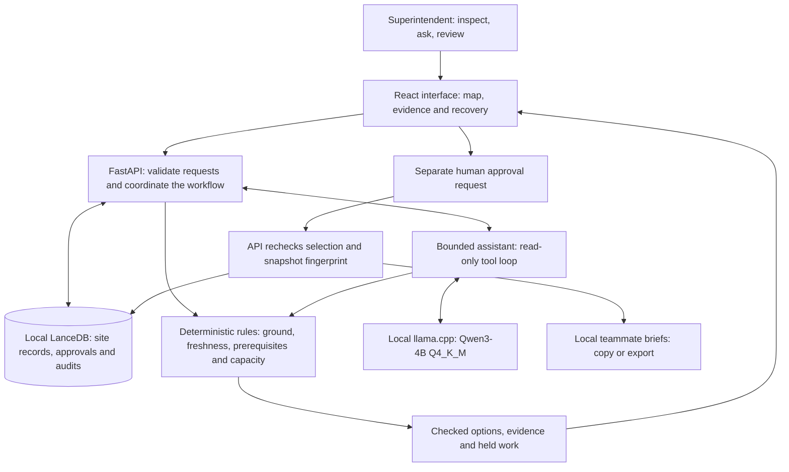
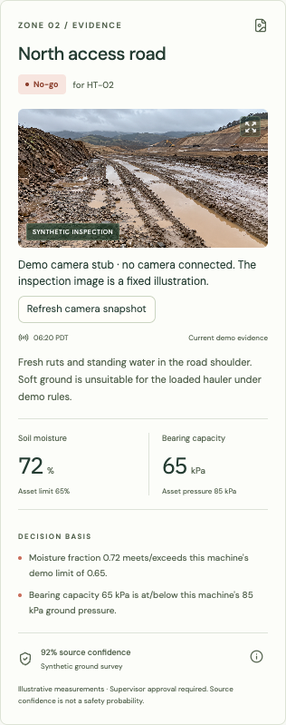
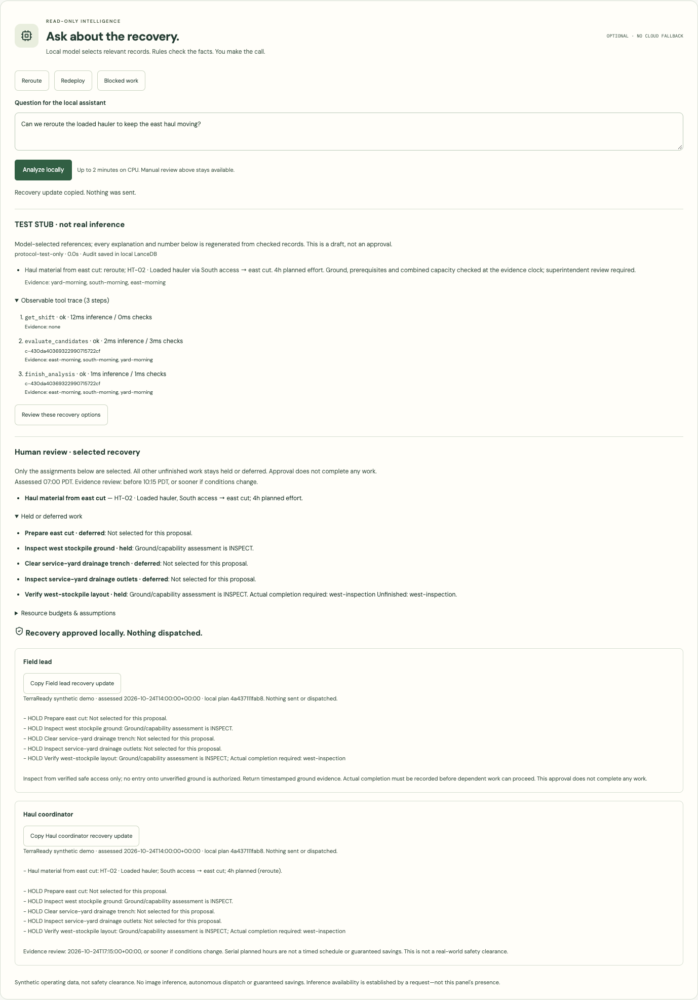

# TerraReady

TerraReady is a local-first, multimodal shift-planning prototype for dynamic ground conditions. It joins aerial context, inspection evidence, weather, equipment constraints, and site rules to produce an auditable **go / inspect / no-go** decision and a revised shift plan.

**Demo status:** operating data is synthetic and the default camera feed is a disconnected stub. A [bring-your-own snapshot adapter](docs/CAMERAS.md) is available; physical camera integrations have not been tested.

## The operating primitive

> Can this asset perform this task, in this place, at this time, under evidence-backed operating constraints?

| Construction | Agriculture | Mining | Forestry |
| --- | --- | --- | --- |
| Excavator × saturated work zone | Planter × wet field strip | Haul truck × rain-soft road | Harvester × protected-soil route |

The first demo focuses on construction earthworks, but the underlying planning primitive applies across physical operations.

## Demo walkthrough

Start with the local setup below. The default demo needs no Mapbox token, model download or Runpod account.

1. **See the disruption.** Keep **HT-02 · Loaded hauler** selected. North access is `NO_GO` after rain. Select the zone to inspect the timestamped synthetic observations and machine-specific reasons.
2. **Compare a recovery.** Choose **South access → east cut** under the current work package. Hauling becomes eligible under the demo rules; the west inspection remains held. The route review below compares the original and revised work.
3. **Review and approve.** Read the holds, evidence deadline and planning limits in **Keep the work. Change the plan.** Check the review box, approve, and copy or download a teammate brief. Reload to see the locally saved approval. Nothing is sent or dispatched.
4. **Try optional assistance.** With the pinned model running, choose **Reroute**, **Redeploy** or **Blocked work** in **Ask about the recovery**. Inspect the facts and tool trace, then choose **Review these recovery options** and approve that exact subset separately. Without a model, the panel labels its rules-only fallback and manual review remains available.
5. **Make evidence expire.** Advance the evidence clock to **12:00**. Stale observations require inspection; the earlier approval cannot authorize the changed snapshot. Return to the shift-start clock to repeat the original scenario.
6. **Inspect the proof.** Open **System & deployment** using the shield link. Current model availability and historical native/GPU test results are shown separately.

The map-first workspace and focused recovery panel are implemented. A complete shift-first screen redesign is deferred. Actual completion, prerequisites and resource budgets are already enforced by the recovery backend.

## How the system works

**The model helps choose what to review. Rules decide what is feasible. A person decides what to approve.**

One host serves the React interface, Python API and optional local model server. LanceDB stores the site's records on that same host; the superintendent uses a browser to reach the interface. The browser sends requests to the API; it never calls the model or database directly.



### Follow one decision

1. **Read the evidence.** In the synthetic post-rain scenario, north access is too soft for the loaded hauler. Stored records include timestamped observations, source confidence and machine-specific limits. The aerial gives location context; its pixels do not establish soil conditions.
2. **Check the work.** Python rules evaluate the destination and every route zone, then check prerequisites, equipment compatibility and combined resource budgets. South access can preserve hauling; stale west-stockpile evidence keeps inspection work held, and its unfinished prerequisite blocks the successor.
3. **Use optional assistance.** The model selects a focused view of the shift, reads stored evidence and asks the rules to check relevant recovery candidates. The API builds the displayed facts from checked records rather than displaying model-authored operational claims.
4. **Review the exact selection.** The superintendent sees proposed work, held/deferred work, evidence references, resource assumptions and the evidence deadline. The model cannot approve its own proposal.
5. **Recheck before saving.** Approval sends the chosen selection back to the API. A fingerprint identifies the snapshot, clock and planning policy; changed or expired evidence requires a fresh review. A valid approval is saved locally and produces role-specific briefs. Approval does not complete work, send messages or dispatch machinery.

### What each part owns

| Part | Responsibility | Implementation |
| --- | --- | --- |
| Browser interface | Show evidence, compare options, collect explicit review and approval | [React workspace](apps/web/src/App.tsx), [assistant panel](apps/web/src/AssistPanel.tsx) |
| API and typed contracts | Validate requests and stored records; coordinate analysis and approval | [FastAPI routes](apps/api/src/terraready/main.py), [domain models](apps/api/src/terraready/models.py) |
| Ground and recovery rules | Determine `GO` / `INSPECT` / `NO_GO`; enforce prerequisites and resource budgets | [Ground engine](apps/api/src/terraready/engine.py), [recovery engine](apps/api/src/terraready/recovery.py) |
| Optional assistant | Select relevant checked records through a small read-only tool allowlist | [Tool loop](apps/api/src/terraready/agent.py), [model transport](apps/api/src/terraready/model_client.py) |
| Local storage | Keep six fixture tables plus approval and assistant-audit history | [Typed LanceDB storage](apps/api/src/terraready/storage.py), [data contract](docs/DATA_CONTRACT.md) |
| Verification evidence | Keep recorded native/GPU measurements separate from current service availability | [Artifact validation](apps/api/src/terraready/system_evidence.py), [System page](apps/web/src/SystemPage.tsx) |

### Why these boundaries matter

- **Rules remain authoritative.** A plausible answer cannot override a ground restriction, stale observation, unfinished prerequisite or resource conflict. The model has no write, approval, shell, SQL or arbitrary-network tool.
- **Assistance can fail without blocking manual planning.** An unavailable model, invalid response or exhausted budget produces a labeled rules-only fallback. Each turn is bounded to five model responses, 960 completion tokens and 120 seconds; there is no hosted-model fallback.
- **The useful record is the checked decision.** Audits retain typed facts, references, tool trace and timings. Questions, free-form model output and hidden reasoning are not retained. An audit-save failure is shown explicitly.
- **Local storage keeps the prototype small.** One API process and one local database support this single-site demo. LanceDB is used for typed records; image embeddings, vector retrieval and visual ground inference are not implemented.
- **Private deployment keeps the same architecture.** During the GPU test, web, API, database and model ran together on one temporary host. Only SSH was exposed; browser access used authenticated forwarding to loopback services. This is not a public service or a production authentication design.

See [architecture decisions](docs/DECISIONS.md) for rationale and [the assistant contract](docs/LOCAL_AGENT.md) for exact tools, limits and model setup.

## Camera integration status

**Camera feeds are stubbed in the default demo.** The inspection picture is a fixed AI-generated illustration, not a real-time camera capture. Soil measurements and current conditions are synthetic fixtures; neither the model nor the image produces them.

For bring-your-own cameras, a typed read-only snapshot interface and opt-in folder adapter let your camera exporter supply PNG/JPEG bytes, a camera/capture ID and capture time. The UI labels external snapshots separately and shows unavailable captures honestly. This does not ingest measurements or change readiness/approval. See [camera adapter setup and contract](docs/CAMERAS.md). Physical camera hardware and vendor protocols have not been tested. The extension passed **296 backend tests and 49 browser tests**, plus an actual folder → API → browser check using a synthetic image. Camera snapshots do not refresh numerical ground evidence.



## Current build

The visual workspace runs against the local FastAPI service and typed LanceDB tables. Select equipment to update ground readiness, inspect a zone's evidence, compare access routes, and advance the evidence clock to see stale observations require inspection.

The backend now also exposes a seven-package work docket and deterministic recovery API at `/api/scenarios/post-rain/recovery`. It models actual completion/prerequisites and paired-resource capacity, reroutes interrupted hauling, pulls forward eligible yard work and keeps the west successor blocked. The assistant panel supports reviewing an exact recovery subset, its holds/deferred work, resource budgets and evidence deadline before separate human approval. The complete shift-first redesign remains deferred. See the [v2 data/recovery contract](docs/DATA_CONTRACT.md#version-2-work-docket-and-recovery).


The aerial is real USGS/USDA NAIP imagery; operational overlays and measurements are synthetic. The inspection photo is an AI-generated illustration, explicitly labeled in the UI and never used to infer quantitative ground conditions. See [asset provenance](ATTRIBUTIONS.md).

Below the map, the original route-only review compares access routes for each assigned asset. Its shortest-eligible-route policy sends both priority-one packages through south access; west-stockpile inspection stays held. The richer recovery planner instead retains an eligible original route before introducing changes, so the excavator can retain north access while hauling reroutes south. Review evidence and planning limits, then approve locally to save a typed LanceDB record and prepare field-lead/haul-coordinator updates. Copy an update or download the route-review Markdown brief. Nothing is sent or dispatched.

Eligibility applies at the selected evidence clock, not for the entire planned duration. The review deadline is 10:15 PDT for the default snapshot; a changed clock or evidence snapshot requires a different approval. Approval is an idempotent local demo artifact, not authenticated sign-off, safety clearance, or a production schedule. The v2 backend checks dependencies and paired-resource hour budgets; neither planner models travel or a timed schedule. Multimodal similarity retrieval remains unfinished; stored image references are not embeddings or visual inference.

An optional [bounded local assistant](docs/LOCAL_AGENT.md) uses Qwen3-4B Q4_K_M through a pinned llama.cpp runtime. It reads the shift/evidence and chooses relevant checked options; backend rules supply all displayed operational claims. It cannot approve or dispatch. Run `make model` after explicit model setup; `make agent-smoke` is separate from protocol-stub CI tests. No hosted model key or Runpod account is needed for local testing.

In **Ask about the recovery**, choose an example or ask a question, inspect cited records and the observable tool trace, then **Review these recovery options**. The model chooses a focused read view before seeing dense data; only checked options in that view may be proposed. Manual route review above remains available if the model is absent or fails. Recovery approval is fingerprint-bound, never automatic, and produces separate copyable teammate updates. Unselected work stays explicitly held or deferred. The panel labels real local inference, test stubs and rules-only fallback distinctly.

Interaction-QA artifact below uses the explicitly labeled **test stub**, not real model output or a performance measurement. Actual native and GPU model results are recorded separately in the typed verification artifacts. [View the real GPU analysis → review → approved-briefs capture](docs/images/gpu-recovery-approved.png); it uses the same synthetic scenario and genuine Qwen inference, not the protocol stub.



### System & deployment evidence

Open [the local System page](http://localhost:5173/system), or use the shield link in the workspace rail. It explains the implemented dataflow, deterministic/model/approval boundaries, edge design intent and actual hardware evidence. A separate authenticated local model-list probe reports current reachability; it does not run inference or turn past tests into a live-quality guarantee.

The page independently validates two sanitized historical artifacts: [native Mac smoke](docs/verification/local-agent.json) and [private GPU integration](docs/verification/gpu-agent.json). They record model/runtime revisions and hashes, dataset/source provenance, host configuration and observed results. Missing, corrupt, incomplete or stub artifacts never become sample measurements.

The private test on **2026-10-25** ran the complete stack on one NVIDIA L4 with a fresh synthetic database and source bundle from commit `45ff57e`:

| Observation | Recorded result |
| --- | --- |
| Real inference | 3/3 task smoke cases and 10/10 warm API requests passed |
| Warm end-to-end API latency | p50 **2.24 s**, p95 **3.04 s**, nearest-rank over ten requests |
| Sampled memory peaks | **3,274 MiB GPU**, **5.94 GiB container**, 419 nominal one-second samples |
| Workflow and failures | Human review/approval/briefs, stopped-model fallback and evidence expiry passed; restart reachability recovered |
| Cleanup and cost | Temporary Pod terminated; no Pods or network volumes remained. Provider-recorded GPU + storage charge **$0.1461** (below the $5 ceiling); earlier account balance decrease was $0.16 |

These are bounded integration observations, not reliability guarantees or absolute memory high-water marks. Container memory includes caches. Startup followed preload; cold-cache performance was not established. Full-stack outbound-network denial remains deferred/unverified. No Jetson, power-efficiency or production-safety result is claimed. The local regression suite passed **268 backend tests and 44 browser tests**; those browser tests use a labeled protocol stub and are separate from real inference evidence.

`make agent-smoke` records actual inference under ignored `.data/reports/`; `python scripts/export_verification.py` prints only the typed public projection for deliberate review/promotion. Never publish the raw local database, model key, `.env.local` or an unreviewed report. Current implementation and verification state: [project state](docs/STATE.md).

The seed demonstrates four distinct outcomes:

| Task / asset | Route | Outcome |
| --- | --- | --- |
| East haul / loaded hauler | North access | `NO_GO` — soft road exceeds this machine's configured limits |
| East haul / loaded hauler | South access | `GO` — all route zones within demo limits |
| East excavation / tracked excavator | North access | `GO` — a different asset has different operating constraints |
| West inspection / utility vehicle | North access | `INSPECT` — stale evidence and marginal access |

These are synthetic demonstrations, not engineering recommendations. Evidence confidence describes source confidence, not the probability of safe operation. Every result still requires supervisor approval.

## Run locally

Requires **Python 3.12**, **Node.js 24 LTS** (or Node 22.13+), npm and [uv](https://docs.astral.sh/uv/getting-started/installation/). Locked installs were verified with uv 0.13.5. Python and Node dependency downloads require internet during setup; model assets are a separate optional download. No credentials are required for the bundled demo.

From a fresh checkout of this repository:

```sh
uv sync --frozen --extra dev --python 3.12
make seed
make api
```

In another terminal, install the frontend and start its preview:

```sh
npm ci
make web
```

Open `http://localhost:5173`. Stop each development service with Ctrl-C in its terminal. Ports 5173 (web) and 8000 (API) must be free; the optional model uses 8080. These are local development servers, not a public deployment.

The default local aerial, fonts, evidence and decision flow require no external connection. Select **Satellite** to opt into Mapbox; a missing token, failed request or unavailable WebGL falls back to the local aerial. Both modes use the same georeferenced synthetic work zones and backend decisions. Mapbox imagery is not bundled.

The API listens at `http://127.0.0.1:8000`; interactive API documentation is at `http://127.0.0.1:8000/docs`. `make seed` resets the six fixture tables: stop the API before reseeding. A seventh approval table and eighth assistant-audit table are created on first use; their history is retained across seeds, but approval is shown only for an exactly matching snapshot/clock/planner fingerprint. The database lives in ignored `.data/lancedb/`. `TERRAREADY_DB_DIR` can point to a different local directory. Run only one API process; concurrent reseeding and multiple writers are outside the POC boundary.

`make seed` explicitly layers `data/fixtures/shift-docket.json` onto the original ground fixture. Back up any needed database history before upgrading; there is no automatic startup migration/reset. Legacy v1 data can still serve the original workspace, but the new recovery API requires v2. Use `/recovery/evaluate` to validate explicit candidate selections and `/recovery/approvals` for fingerprint-bound local approval; neither approval completes a task or sends a message.

```sh
curl -sS http://127.0.0.1:8000/api/scenarios/post-rain
curl -sS http://127.0.0.1:8000/api/scenarios/post-rain/evaluate \
  -H 'Content-Type: application/json' \
  -d '{"task_id":"east-haul","machine_id":"loaded-hauler","route_id":"north-to-east"}'
```

Switch `route_id` to `south-to-east` to compare the alternate route. An optional timezone-aware `as_of` later than the fixed scenario clock demonstrates evidence expiry.

`/health` checks process liveness; `/ready` validates the stored site snapshot. An unseeded or incomplete database returns `503` with a recovery instruction. Invalid requests return `422`, and unknown records return `404`.

### Common setup and demo issues

| Symptom | What to do |
| --- | --- |
| API says the data is not ready | In a new checkout, run `make seed` before starting the API. On an existing demo, stop the API and preserve needed history before deliberately reseeding. |
| Assistant says the model is unavailable | This is expected without optional [model setup](docs/LOCAL_AGENT.md). Use manual review, or complete the pinned downloads and start `make model` in another terminal. No hosted-model key is needed. |
| The map provider fails or no token is configured | Use **Local aerial**. The bundled map and decision workflow do not require Mapbox. |
| Approval disappears after changing the clock | The earlier approval belongs to its exact evidence snapshot and selection. Review the updated proposal; stale or all-held work cannot be approved. |
| A service cannot bind its port | Stop your duplicate process or use a separate checkout with explicit test ports. Do not kill unrelated services or reset an existing database. |

## Verify

```sh
make check
uv build
```

With `make api` running in another terminal, `make smoke` verifies real HTTP responses for all three decision states against the seeded LanceDB records.

The check command runs formatting, lint, strict backend type checks and unit/API/LanceDB integration tests with branch coverage. Tests use disposable databases. `uv build` creates backend source/wheel packages; these are not a standalone full-web-app installer. Use a Git checkout for the complete demo and its bundled assets.

```sh
make web-check
PLAYWRIGHT_BROWSERS_PATH=.data/pw-browsers npx playwright install chromium
make browser-check
```

Once the runtimes are installed, `make verify` runs the complete backend, frontend and browser verification sequence.

Playwright starts isolated services on ports 8001/5174 and uses `.data/e2e-lancedb/`, leaving your running demo and approvals untouched. The test-only reset script drops only the approval table in that fixed disposable database. The browser suite blocks all external requests and uses an intentionally invalid Mapbox token for provider-failure coverage. It verifies equipment changes, zone evidence, route outcomes, evidence expiry, plan approval, persisted reload, both teammate briefs, clipboard/download, recovery states, keyboard controls, mobile layout, accessibility and a screenshot baseline. Failure traces, screenshots and videos are saved locally. Browser tests do not need your real Mapbox token.

CI runs backend and workspace checks independently and retains browser failure artifacts for seven days. CI has not yet run on GitHub because this repository has not been pushed. The visual baseline allows 3% pixel variation for cross-platform rendering; updates require deliberate review.

### Reproduction status — October 25, 2026

A separate clean local Git checkout installed locked Python/npm dependencies and Chromium into fresh directories, without copying the development environment, credentials, database or model. Verified on macOS arm64 with Python **3.12.12**, uv **0.13.5** and Node **24.22.1**:

- `make verify`: formatting, lint, types, production build, **268 backend tests** (**99.42%** API statement/branch coverage) and **44 browser tests** passed. The browser suite uses its labeled model-protocol stub.
- Two explicit fixture seeds and live HTTP ground/recovery checks passed. A separate browser run against the **real API without a model installed** verified fallback, manual approval, correct copied brief, persisted reload, evidence expiry and mobile layout. It made no external browser requests.
- `uv build` produced backend source/wheel packages; member review found no credential/database/cache paths and confirmed source-package attribution. Two allowlisted source exports were byte-identical, with all member hashes checked and both reviewed native/GPU evidence artifacts retained.

The checked application revision was `a6c39d4`; final source-package/attribution and manual-demo checks used `82feb5a`. Later README/checkpoint edits do not change application behavior. GitHub CI has not run remotely and no public service is deployed. Browser request blocking does not prove backend outbound-network isolation. Existing npm ESLint-support and lazy Mapbox bundle-size advisories remain; dependency upgrades are outside this verified slice.

## POC boundaries

TerraReady is not a safety-certified system, trafficability model, or machine-control product. All v1 operational layers and inspection evidence are synthetic and visibly labeled as such. The bundled real aerial is attributed in [asset provenance](ATTRIBUTIONS.md). Agriculture, mining and forestry illustrate the shared decision pattern above; they are not separate implemented demos.

## Project documents

- [Goals and scope](docs/GOALS.md)
- [Build plan](docs/PLAN.md)
- [Current project state](docs/STATE.md)
- [Architecture decisions](docs/DECISIONS.md)
- [Data and decision contract](docs/DATA_CONTRACT.md)
- [Research and business rationale](docs/RESEARCH.md)

## Local configuration

The frontend reads optional `VITE_MAPBOX_TOKEN` from the repository-root `.env.local`. The backend does not load that file. Use a dedicated public token restricted to your development origins (`http://localhost:5173` and `http://127.0.0.1:5173` as appropriate); never commit it. Public client tokens are visible to the browser by design. Static build output is ignored by Git and should not be published without reviewing token restrictions.

## License

Code and original project assets are released under the [MIT License](LICENSE). Third-party and public-domain materials retain their own terms, recorded in [ATTRIBUTIONS.md](ATTRIBUTIONS.md); bundled font licenses accompany the web build. Model weights are Apache-2.0 and llama.cpp is MIT, with pinned sources in [model setup](docs/LOCAL_AGENT.md).
