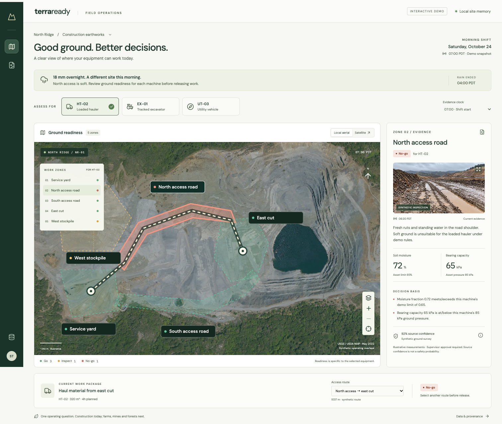

# TerraReady

TerraReady is a local-first, multimodal shift-planning prototype for dynamic ground conditions. It joins aerial context, inspection evidence, weather, equipment constraints, and site rules to produce an auditable **go / inspect / no-go** decision and a revised shift plan.

## The operating primitive

> Can this asset perform this task, in this place, at this time, under evidence-backed operating constraints?

| Construction | Agriculture | Mining | Forestry |
| --- | --- | --- | --- |
| Excavator × saturated work zone | Planter × wet field strip | Haul truck × rain-soft road | Harvester × protected-soil route |

The first demo focuses on construction earthworks, but the underlying planning primitive applies across physical operations.

## What the v1 demo will show

- A site superintendent reviews a post-rain shift on a visual site map.
- The system assesses machine-and-zone feasibility using explicit, deterministic rules.
- A marginal or stale-evidence condition becomes **Inspect**, never invented certainty.
- The superintendent approves a revised plan and produces role-specific updates for a field lead and haul coordinator.
- The same user flow works offline with local data. A connected Mapbox map is an optional visual enhancement.

## Current build

The visual workspace now runs against the local FastAPI service and six typed LanceDB tables. Select equipment to update ground readiness, inspect a zone's evidence, compare access routes, and advance the evidence clock to see stale observations require inspection.



The aerial is real USGS/USDA NAIP imagery; operational overlays and measurements are synthetic. The inspection photo is an AI-generated illustration, explicitly labeled in the UI and never used to infer quantitative ground conditions. See [asset provenance](ATTRIBUTIONS.md).

Revised-plan approval, role-specific teammate updates and multimodal similarity retrieval remain unfinished. Manual route comparison in the current workspace does not automatically replan or release work.

The seed demonstrates four distinct outcomes:

| Task / asset | Route | Outcome |
| --- | --- | --- |
| East haul / loaded hauler | North access | `NO_GO` — soft road exceeds this machine's configured limits |
| East haul / loaded hauler | South access | `GO` — all route zones within demo limits |
| East excavation / tracked excavator | North access | `GO` — a different asset has different operating constraints |
| West inspection / utility vehicle | North access | `INSPECT` — stale evidence and marginal access |

These are synthetic demonstrations, not engineering recommendations. Evidence confidence describes source confidence, not the probability of safe operation. Every result still requires supervisor approval.

## Run locally

Requires Python 3.12 and [uv](https://docs.astral.sh/uv/getting-started/installation/). From the repository root:

```sh
uv sync --frozen --extra dev
make seed
make api
```

In another terminal, install the frontend and start its preview:

```sh
npm ci
make web
```

Open `http://localhost:5173`. The default local aerial, fonts, evidence and decision flow require no external connection. Select **Satellite** to opt into Mapbox; a missing token, failed request or unavailable WebGL falls back to the local aerial. Both modes use the same georeferenced synthetic work zones and backend decisions. Mapbox imagery is not bundled.

The API listens at `http://127.0.0.1:8000`; interactive API documentation is at `http://127.0.0.1:8000/docs`. `make seed` resets the six demo tables: stop the API before reseeding. The database lives in ignored `.data/lancedb/`. `TERRAREADY_DB_DIR` can point to a different local directory.

```sh
curl -sS http://127.0.0.1:8000/api/scenarios/post-rain
curl -sS http://127.0.0.1:8000/api/scenarios/post-rain/evaluate \
  -H 'Content-Type: application/json' \
  -d '{"task_id":"east-haul","machine_id":"loaded-hauler","route_id":"north-to-east"}'
```

Switch `route_id` to `south-to-east` to compare the alternate route. An optional timezone-aware `as_of` later than the fixed scenario clock demonstrates evidence expiry.

`/health` checks process liveness; `/ready` validates the stored site snapshot. An unseeded or incomplete database returns `503` with a recovery instruction. Invalid requests return `422`, and unknown records return `404`.

## Verify

```sh
make check
uv build
```

With `make api` running in another terminal, `make smoke` verifies real HTTP responses for all three decision states against the seeded LanceDB records.

The check command runs formatting, lint, strict backend type checks and unit/API/LanceDB integration tests with branch coverage. Tests use disposable databases.

```sh
make web-check
PLAYWRIGHT_BROWSERS_PATH=.data/pw-browsers npx playwright install chromium
make browser-check
```

Once the runtimes are installed, `make verify` runs the complete backend, frontend and browser verification sequence.

Playwright starts the API and frontend when needed. Stop any manually running API before letting tests reseed it. The browser suite blocks all external requests, uses an intentionally invalid Mapbox token for provider-failure coverage, and verifies equipment changes, zone evidence, route outcomes, evidence expiry, keyboard controls, mobile layout, dialogs, recovery states, accessibility and a screenshot baseline. Failure traces, screenshots and videos are saved locally. Browser tests do not need your real Mapbox token.

CI runs backend and workspace checks independently and retains browser failure artifacts for seven days. CI has not yet run on GitHub because this repository has not been pushed. The visual baseline allows 3% pixel variation for cross-platform rendering; updates require deliberate review.

## POC boundaries

TerraReady is not a safety-certified system, trafficability model, or machine-control product. All v1 operational layers and inspection evidence are synthetic and visibly labeled as such. The final README will include a real aerial base-map attribution and visual cross-vertical examples.

## Project documents

- [Goals and scope](docs/GOALS.md)
- [Build plan](docs/PLAN.md)
- [Current project state](docs/STATE.md)
- [Architecture decisions](docs/DECISIONS.md)
- [Data and decision contract](docs/DATA_CONTRACT.md)
- [Research and business rationale](docs/RESEARCH.md)

## Local configuration

The frontend reads optional `VITE_MAPBOX_TOKEN` from the repository-root `.env.local`. The backend does not load that file. Use a dedicated public token restricted to your development origins (`http://localhost:5173` and `http://127.0.0.1:5173` as appropriate); never commit it. Public client tokens are visible to the browser by design. Static build output is ignored by Git and should not be published without reviewing token restrictions.

## License

Code and original project assets are released under the [MIT License](LICENSE). Third-party and public-domain data are identified separately in `ATTRIBUTIONS.md` when added.
