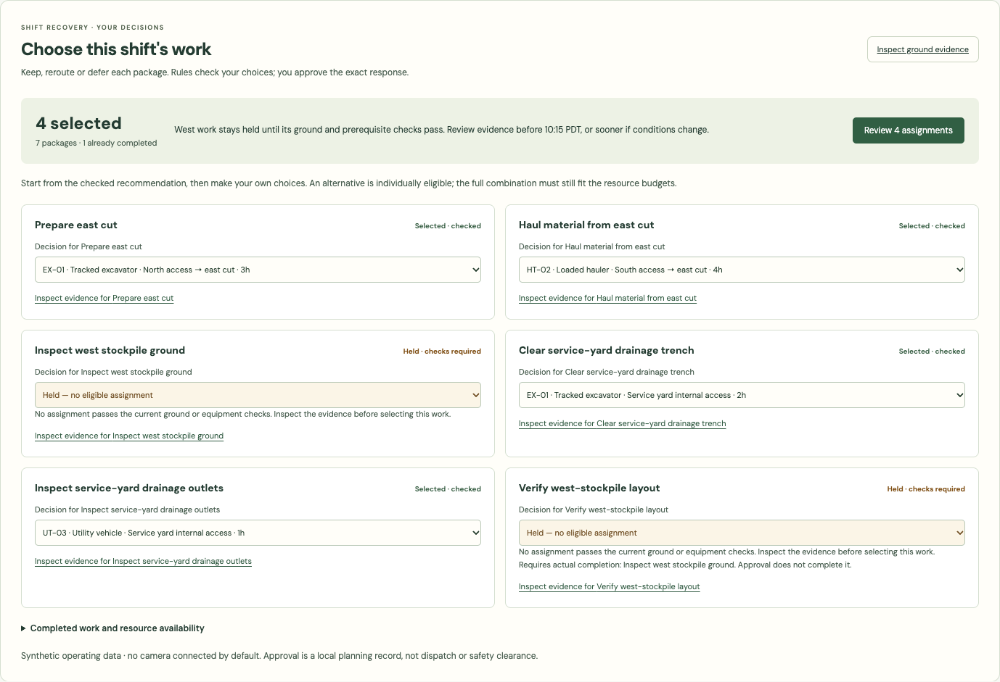
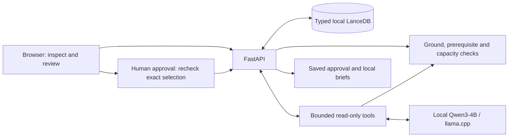

# TerraReady

Overnight rain makes the north access road unsuitable for a loaded hauler. Can hauling continue on another route? What work can the excavator pull forward? What must stay held?

TerraReady is a construction-earthworks planning prototype for answering those questions from timestamped ground evidence, machine limits, unfinished prerequisites and resource budgets. The superintendent chooses or defers each package and selects checked route/resource alternatives. Independent rules check the combination before exact human approval; an optional small local model helps choose what to examine.

**Demo data is synthetic.** The aerial is real, attributed NAIP imagery. The default camera is a disconnected stub with a fixed illustration; neither images nor the model produce soil measurements. [Camera snapshot adapters](docs/CAMERAS.md) are implemented; physical-camera integration is untested.



## Try the decision

**[Open the live demo](https://terraready-controller.terraready-itikku.workers.dev/demo)** — no account or email code. Choose **Start live demo**, wait a few minutes for the GPU, then open the workspace. Visitors share one model and budget; each browser has its own planning decisions. Return to the same link to join or restart within the available allowance. [Session policy and limits](docs/HOSTED_DEMO.md).

The local demo below needs no model, Mapbox token or cloud account.

1. Start in **Choose this shift's work**. The checked recommendation preserves excavation, reroutes hauling and pulls forward ready yard work; west work stays held.
2. Make a decision for each package. Try **Defer this package** for yard drainage, or choose an eligible alternate route for excavation. Held packages cannot be released by changing a dropdown.
3. Choose **Review 3 assignments** (the count follows your choices). The API rechecks the exact combination, capacities and evidence deadline. Confirm and approve, then copy the field-lead or haul-coordinator brief. Reload to see the checked selection and its saved approval in this browser session.
4. Set **Evidence clock** to **12:00**. Stale evidence requires inspection and the earlier approval cannot authorize that changed snapshot.

The primary recovery covers seven packages with actual completion, prerequisites and paired-resource hour budgets. **Inspect ground evidence** opens the supporting map/equipment workspace. **Compare routes for original work** retains a separately scoped three-package route review. Optional assistance also reviews its own selection; it does not overwrite your package choices. Approvals never complete work or dispatch machinery.

## Why this architecture fits

**The model selects relevant checked records. Rules establish feasibility. A person approves.**



The browser reaches the API; it never calls the model or database directly. The local and hosted demonstrations run the API, database and model together on one host. React provides the evidence workspace; Python/FastAPI/Pydantic validate boundaries, and Arrow preserves explicit LanceDB schemas. In the hosted demo, a Cloudflare Worker signs requests and a Durable Object coordinates the shared GPU lease and budget.

| Use-case need | Decision and benefit | Tradeoff |
| --- | --- | --- |
| A wet route can suit one asset and exclude another; observations age. | [Machine-specific rules](apps/api/src/terraready/engine.py) check every route zone, evidence freshness and static restrictions. Reasons cite stored observations. | Synthetic thresholds explain the workflow; they are not a validated trafficability model. |
| A plausible model answer cannot establish ground conditions or capacity. | A [focus-first tool loop](apps/api/src/terraready/agent.py) reads known records and checked candidates. Python regenerates displayed facts; the model cannot write, approve or dispatch. | Narrower than open-ended advice. Five responses, 960 completion tokens and 120 seconds bound a turn; failure returns labeled manual recovery. |
| Evidence or selection can change before someone approves. | [Approval rechecks](apps/api/src/terraready/main.py) recompute constraints and bind the exact snapshot, clock and policy to a fingerprint. Repeated requests preserve the saved approval. | Local demo approval is not authenticated sign-off. It does not complete prerequisites or reserve real machinery. |
| The prototype needs inspectable evidence and repeatable tests on one host. | [Typed LanceDB tables](apps/api/src/terraready/storage.py) store fixtures, approvals and structured audit facts. Synthetic fixtures reproduce edge cases. | One API writer; no distributed transactions, embeddings or vector-search claim. Questions and free-form model prose are not retained in audits. |
| A supplied photograph must remain distinguishable from a ground measurement. | A bounded [snapshot contract](docs/CAMERAS.md) carries image identity, capture time and digest; missing captures stay unavailable. | No vendor/video driver, visual inference or automatic measurement ingestion. Images cannot refresh stale ground evidence. |

Ground eligibility is only one gate. The recovery engine also rejects unfinished prerequisites, incompatible resources and conflicting selections. Hour budgets describe serial planned effort, not a time-optimized schedule or measured productivity savings. Rules-only planning remains available when inference fails.

## Budget controls

The shared-demo policy treats cost as an admission and resource-lifecycle constraint: **$1.50 per Los Angeles day across all visitors/runs**, **$5 lifetime usage**, and **two active hours maximum from first use**. Startup, idle, disk and cleanup count. Joining never renews an allowance; the separate $10 prepaid funding limit is not a usage budget.

The [Cloudflare ledger](apps/controller/README.md) reserves conservative whole-host costs atomically before creating one GPU. Setup has a twenty-minute cutoff; thirty minutes without meaningful use ends a ready/active run. Joining refreshes idle time without resetting the two-hour deadline. Status polling does neither. A cost limit can end a run sooner. One model loop and a bounded queue share fixed capacity; browser workspaces separate approvals and audits.

**Public start, real inference, automatic cleanup and restart are verified.** Reviewers need no sign-in; only owner setup/global-stop controls use Cloudflare Access. Durable alarms check readiness and delete the recorded Pod on stop or expiry, retrying failed cleanup. An uncertain creation blocks a duplicate start. Exact-ID provider checks confirmed deletion in both live lifecycle proofs; no test GPU was left running.

After confirmed deletion, the ledger replaces the reservation with a conservative usage debit, including cleanup margin. This releases unused allowance without pretending delayed provider bills are final. Invoice reconciliation remains manual. Provider/API failures can delay cleanup: these are application controls, not a provider-enforced dollar cap. [Lifecycle, accounting and limitations](docs/HOSTED_DEMO.md) give the details.

## Run locally

Requires Python **3.12**, Node **24 LTS** (or 22.13+), npm and [uv](https://docs.astral.sh/uv/getting-started/installation/). Locked installs were verified with uv **0.13.5**. Setup downloads dependencies; runtime model assets are an explicit optional setup.

From a **fresh checkout**:

```sh
git clone https://github.com/itikku/terraready.git
cd terraready
uv sync --frozen --extra dev --python 3.12
make seed
make api
```

In another terminal:

```sh
npm ci
make web
```

Open `http://localhost:5173`. The API uses loopback port 8000; optional inference uses 8080. Stop each service with Ctrl-C. **Reseeding replaces fixture tables:** on an existing checkout, stop the API and preserve needed history before doing it. Do not reseed as a generic startup step.

The bundled aerial, fonts and manual decision flow work without external requests. Mapbox is optional and falls back to the local aerial. [Running and troubleshooting](docs/RUNNING.md) covers ports, database lifecycle, endpoint examples and optional map configuration.

For actual inference, follow the pinned downloads/hash checks in [model setup](docs/LOCAL_AGENT.md), then run `make model` and `make agent-smoke`. The approved model is **Qwen3-4B Q4_K_M** served by **llama.cpp b11669**. Without it, the interface labels rules-only fallback. A protocol stub used in browser tests is never presented as genuine inference.

## What has been verified

| Evidence | Result and scope |
| --- | --- |
| [GitHub checks](https://github.com/itikku/terraready/actions/workflows/ci.yml) | Backend, browser and controller/gateway tests, formatting, lint, types, build, live HTTP checks and package builds. Browser model tests use a labeled protocol stub. |
| [Private L4 integration](docs/verification/gpu-agent.json) | Real Qwen inference: 3/3 smoke cases and 10/10 warm API requests. Warm end-to-end p50 **2.24 s**, p95 **3.04 s**, nearest-rank over ten requests. |
| Same GPU test | Sampled peaks **3,274 MiB GPU**, **5.94 GiB container**; real approval/briefs, stopped-model fallback and expiry checked. Temporary Pod terminated; later provider billing revised the charge to **$0.1555** including disk; the artifact retains the earlier billing snapshot. |
| [Hosted lifecycle proof](docs/HOSTED_DEMO.md#verified-preview) | Anonymous start → real workspace/Qwen analysis → controller deletion → fresh start/readiness → controller deletion. One analysis displayed **1.6 s** and three tool steps; an integration smoke, not a benchmark or real multiuser load test. |
| [Camera interface tests](docs/CAMERAS.md#what-has-been-verified) | Synthetic folder exporter → API → browser, plus missing/invalid capture handling. No physical-camera test. |

The GPU run used source `45ff57e`, before the camera extension. These small samples establish integration, not reliability, cold-cache behavior, absolute memory peaks or production safety. Container memory includes caches. Jetson, power efficiency and enforced backend outbound-network denial are unverified. The [native artifact](docs/verification/local-agent.json) is separate; the System page distinguishes recorded tests from current model reachability.

```sh
PLAYWRIGHT_BROWSERS_PATH=.data/pw-browsers npx playwright install chromium
make verify
uv build
```

Verification uses disposable test databases and explicit protocol fixtures. Stop conflicting test previews before using ports 5174/8001/8082. `uv build` packages the backend; use the Git checkout for the complete web demo. See [verification/setup notes](docs/RUNNING.md#verification-and-reproduction) for prerequisites and historical clean-checkout provenance.

## Scope and extensions

The working vertical is construction. The same **asset × operation × location × evidence time** question motivates a planter on wet soil, a haul truck on a rain-soft mining road or a forestry harvester on a protected route. Those are transfer opportunities, not three additional implementations.

This is a planning POC, not a safety-certified system, validated soil model or machinery controller. It has no live weather/telemetry ingestion, visual model, external messaging or optimal schedule. Camera pictures remain separate context. Anonymous access and the GPU lifecycle are verified; real multiuser inference load, Free-tier capacity and automated invoice reconciliation remain unverified or unfinished.

References: [data/rules contract](docs/DATA_CONTRACT.md), [model/tools](docs/LOCAL_AGENT.md), [camera adapters](docs/CAMERAS.md), [architecture decisions](docs/DECISIONS.md), [research rationale](docs/RESEARCH.md).

Original code/assets use [MIT](LICENSE). Public-domain imagery and third-party materials retain their terms in [ATTRIBUTIONS](ATTRIBUTIONS.md), including bundled font licenses. Qwen weights are Apache-2.0; llama.cpp is MIT, with pinned sources in model setup.
