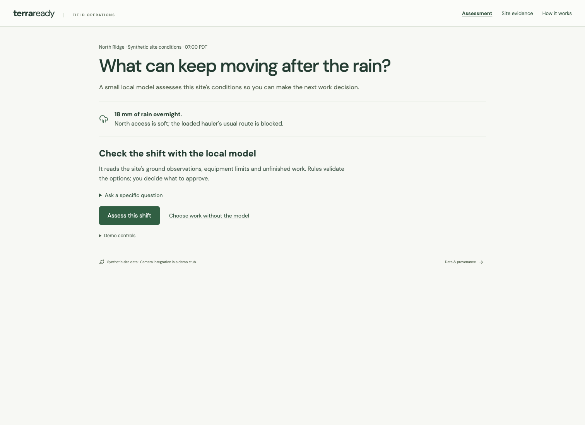
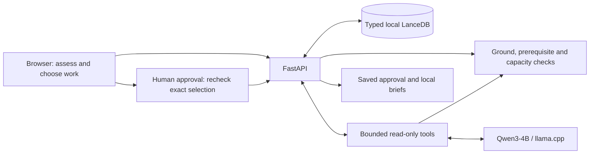

# TerraReady

## [Try the live demo →](https://terraready-controller.terraready-itikku.workers.dev/demo)

TerraReady helps a site superintendent replan earthworks when ground conditions change. A small local model reads the site's observations, equipment limits and unfinished work. Rules check which options are feasible; you choose and approve the plan.

Explore a simulated rainy shift with real Qwen inference. Start or join a session without signing in. A cold start takes a few minutes; availability follows the [shared budget policy](docs/HOSTED_DEMO.md#budget-controls).



## Follow the rainy shift

Overnight rain makes north access unsuitable for a loaded hauler. The excavator has other ready work, while west-stockpile work must wait for inspection and unfinished prerequisites.

1. **Assess this shift.** The model retrieves relevant site records and returns checked findings. Expand the evidence and tool trace to see what it examined.
2. **Choose work to approve.** Keep an assignment, choose an eligible route or defer a package. The editor checks the combined resource hours and preserves holds.
3. **Review and approve.** Confirm the exact selection, then copy the field-lead or haul-coordinator brief. Changes to evidence or selection require another check.

**Choose work without the model** keeps manual planning available during an inference outage. The work list stays beside the interactive map. Select a package to locate it, then open **Site evidence** for observations and camera context. Approving a plan saves a planning record; it does not dispatch equipment or complete work.

## Why this architecture fits

The model's job is to find the relevant records and checked alternatives. Python rules establish feasibility. The superintendent approves the work.



The model, API and site database run together on one host. The same boundary works on the local machine and the hosted GPU. Qwen3-4B Q4_K_M runs through llama.cpp on a loopback interface beside the site database.

| Use-case need | Technical decision | Benefit and tradeoff |
| --- | --- | --- |
| The same wet route affects a hauler and excavator differently; observations also expire. | [Machine-specific rules](apps/api/src/terraready/engine.py) check every route zone, evidence age and static restriction. | Rejections cite stored evidence. The thresholds demonstrate the workflow; geotechnical validation remains outside this prototype. |
| A small model must stay focused and cannot establish safe operating conditions. | A [read-only tool loop](apps/api/src/terraready/agent.py) retrieves records and checked candidates. Python regenerates displayed facts. Five responses, 960 completion tokens and 120 seconds bound a turn. | Inspectable assistance with a limited scope. Failure returns labeled manual recovery; the model has no write or approval tool. |
| Conditions or choices may change before approval. | The [approval API](apps/api/src/terraready/main.py) rechecks constraints and fingerprints the exact selection, snapshot, clock and policy. | Stale selections cannot reuse an approval. Demo approval is a local planning record, not authenticated field sign-off. |
| Evidence and decisions need to be inspectable on one host. | [Typed LanceDB tables](apps/api/src/terraready/storage.py) hold fixtures, approvals and structured audit facts. Arrow preserves their schemas. | Repeatable tests and queryable history with one API writer. Embeddings, vector retrieval and distributed transactions are not implemented. Free-form model prose is not retained in audits. |

Prerequisites and paired-resource hour budgets are checked alongside ground conditions. Planned hours describe serial effort; the prototype does not calculate an optimal timed schedule or measured productivity savings.

### Where the math runs

Calculations run in Python, independently of Qwen. **Show the math** exposes the inputs, limits, evidence clock and checked result; the model cannot skip these checks or change their thresholds.

| Example | Deterministic check |
| --- | --- |
| Loaded hauler on north access | Bearing headroom: `65 − 85 = −20 kPa` → blocked. The excavator's `65 − 42 = 23 kPa` passes this check. |
| An old ground reading looks favourable | Observation age, post-rain timing and confidence must pass before its numbers can support release. |
| Two packages share an excavator | Combined planned effort must fit its remaining hours; approval rechecks the exact selection. |

These are explicit synthetic operating rules, not a validated soil-physics model. The [Vinci research comparison](docs/reviews/VINCI_RESEARCH.md) explains the distinction between this tool-assisted workflow and a physics-native neural/numerical solver.

## Budget controls

The hosted demo shares **one GPU**, **$2 per Los Angeles calendar day** and a **$10 lifetime usage ceiling** across every visitor and restart. More visitors mainly add queueing to fixed capacity. GPU time continues to cost money during startup and idle periods.

The [Cloudflare controller](apps/controller/README.md) reserves whole-host costs before creation and persists the resource identity and deadlines. A session lasts at most two hours from first use, with a thirty-minute idle cutoff. Setup has a twenty-minute cutoff; cost can end a session sooner. Joining does not renew an allowance. The separately approved $10 prepaid funding limit is distinct from usage.

The [prebuilt runtime](deploy/README.md) moves installs and builds off the rented GPU. Its first uncached start still took **176 seconds**, dominated by pulling the model-bearing image; a substantial cold-start speedup has not been demonstrated.

Durable alarms delete the recorded Pod on stop or expiry and retry failed cleanup. Uncertain creation blocks duplicate starts. Confirmed deletion releases unused reservation after a conservative debit. Delayed provider-bill reconciliation remains manual. These controls are implemented in the application; provider outages can delay cleanup. [Lifecycle evidence and accounting limits](docs/HOSTED_DEMO.md) explain what has been verified.

## What has been verified

| Evidence | Result and scope |
| --- | --- |
| [Automated checks](https://github.com/itikku/terraready/actions/workflows/ci.yml) | Backend, controller and browser tests; formatting, lint, types, production build, live HTTP checks and package builds. Browser inference tests use a labeled protocol stub. |
| [Real L4 inference](docs/verification/gpu-agent.json) | Qwen passed 3/3 smoke cases and 10/10 warm API requests. End-to-end p50 **2.24 s**, p95 **3.04 s**, nearest-rank over ten requests. Sampled peaks: **3,274 MiB GPU**, **5.94 GiB container**. |
| [Hosted lifecycle](docs/HOSTED_DEMO.md#verified-preview) | Public start, genuine inference, controller deletion, fresh start and deletion again. Independent provider reads confirmed absence. Individual hosted smokes are separate from the measured latency sample. |
| [Camera adapters](docs/CAMERAS.md#what-has-been-verified) | A synthetic folder exporter reaches the API/browser, with missing and invalid captures handled. Physical-camera acquisition remains untested. |

The measured L4 run used source `45ff57e`, before camera adapters. Its later provider charge was **$0.1555**, including disk. These small samples establish integration. Reliability, real multiuser inference load, Jetson, power efficiency and enforced backend outbound-network denial remain unverified. The [native artifact](docs/verification/local-agent.json) records a separate local test; System distinguishes recorded measurements from current model reachability.

## Data sources and demo boundaries

The operating measurements, equipment and shift scenario are synthetic. The aerial is real public-domain NAIP imagery, with attribution in [ATTRIBUTIONS](ATTRIBUTIONS.md).

The default camera is a disconnected stub with a fixed illustration. Neither images nor the model produce soil measurements. The [camera adapter contract](docs/CAMERAS.md) accepts developer-supplied still snapshots; photographs remain separate context and cannot refresh stale ground evidence.

TerraReady is a planning prototype. Ground rules are illustrative and have not been certified for operational safety. Live weather/telemetry ingestion, visual inference and external messaging are not implemented. The implemented vertical is construction. The same asset × operation × location × evidence-time question could apply to farming, mining or forestry; those are extension opportunities.

## Run locally

Requires Python **3.12**, Node **24 LTS** (or 22.13+), npm and [uv](https://docs.astral.sh/uv/getting-started/installation/). Locked installs were verified with uv **0.13.5**. Setup downloads dependencies; runtime model assets are an explicit optional setup.

From a **fresh checkout**:

```sh
git clone https://github.com/itikku/terraready.git
cd terraready
uv sync --frozen --extra dev --python 3.12
make seed
make api
```

In another terminal:

```sh
npm ci
make web
```

Open `http://localhost:5173`. The API uses loopback port 8000; optional inference uses 8080. Stop each service with Ctrl-C. **Reseeding replaces fixture tables:** on an existing checkout, stop the API and preserve needed history before doing it. Do not reseed as a generic startup step.

The bundled aerial, fonts and manual decision flow work without external requests. Mapbox is optional and falls back to the local aerial. [Running and troubleshooting](docs/RUNNING.md) covers ports, database lifecycle, endpoint examples and optional map configuration.

For actual inference, follow the pinned downloads/hash checks in [model setup](docs/LOCAL_AGENT.md), then run `make model` and `make agent-smoke`. The approved model is **Qwen3-4B Q4_K_M** served by **llama.cpp b11669**. Without it, the interface labels rules-only fallback. A protocol stub used in browser tests is never presented as genuine inference.

## Verify and inspect

```sh
PLAYWRIGHT_BROWSERS_PATH=.data/pw-browsers npx playwright install chromium
make verify
uv build
```

Checks use disposable test databases and explicit protocol fixtures. Stop conflicting test previews before using ports 5174/8001/8082. `uv build` packages the backend; the Git checkout supplies the complete web demo. [Reproduction notes](docs/RUNNING.md#verification-and-reproduction) record setup prerequisites and historical clean-checkout results.

References: [data/rules contract](docs/DATA_CONTRACT.md), [model/tools](docs/LOCAL_AGENT.md), [camera adapters](docs/CAMERAS.md), [architecture decisions](docs/DECISIONS.md), [research rationale](docs/RESEARCH.md).

Original code/assets use [MIT](LICENSE). Imagery, bundled fonts and third-party materials retain their terms in [ATTRIBUTIONS](ATTRIBUTIONS.md). Qwen weights are Apache-2.0; llama.cpp is MIT, with pinned sources in model setup.
