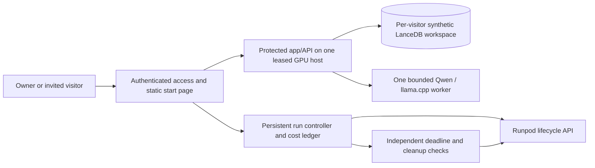

# On-demand shared demo: architecture and readiness

Design, 2026-10-25. The user approved Cloudflare Free for the controller, access and persistent budget ledger. Account access, invitation setup and implementation remain unverified. No new resource, account, deployment or funding has been created. The earlier private GPU integration is historical proof; it is not an on-demand multiuser service. Provider facts below were checked against official documentation on this date; design recommendations are inferences, not verified deployment capabilities.

## Recommendation for the first hosted slice

Use **one GPU lease shared by an authenticated run**, controlled by a small service that remains reachable while the GPU is off. Keep the tested Python/LanceDB/llama.cpp stack together initially. This avoids simultaneously migrating the model protocol, moving operational storage and building a new serverless handler.

The selected controller is **Cloudflare Workers + one SQLite-backed Durable Object**, with invite-only access in front. Provider choice is approved; the account and access mechanism are not configured. Keep it on the Free plan without a paid upgrade, and verify actual account quotas/access before deployment. Workers Free has a 10 ms request CPU limit and 100,000 daily requests; the controller must be benchmarked within those limits and configured to fail closed. [Workers limits](https://developers.cloudflare.com/workers/platform/limits/)

SQLite-backed Durable Objects are available on Free; excess free-tier operations fail instead of becoming unlimited free capacity. Their provider quota reset is UTC, distinct from our Los Angeles budget day. Store only run/access/budget metadata there; domain records remain in LanceDB. [Durable Objects pricing](https://developers.cloudflare.com/durable-objects/platform/pricing/)

The controller handles starts, accounting and shutdown; it does not reimplement ground rules. A gateway must protect both visitor access and the GPU origin: direct-origin requests without valid server-side authorization must fail. Model and database remain unreachable from the browser directly. Do not expose the current unauthenticated API as a shortcut.

Start permissions initially belong to the owner; invitees can join a ready run. Expand start rights only through an explicit owner policy. Each visitor receives a separate synthetic workspace; approvals/questions/audits cannot leak between visitors. The existing model loop remains shared and bounded. A new run starts from fixtures; cross-run operational history is not a v1 requirement. No existing local database or key is transferred.

## Why not the other immediate options

### Cloudflare Free versus Vercel Hobby

**Decision: keep Cloudflare**, reaffirmed after the user's comparison request. Both can serve the start page; the deciding requirement is coordinating a shared, persistent allowance and deadlines while the GPU is off. This is an architectural assessment against current official documentation, not a comparative production benchmark.

| Requirement | Cloudflare design | Straightforward Vercel alternative |
| --- | --- | --- |
| Ten people start/join without duplicating a GPU or spending allowance | One SQLite-backed Durable Object serializes transactional ledger updates. | Functions/Workflows plus a transactional store, such as Marketplace Postgres or Redis, for shared admission. This is our proposed implementation, not a claim that Vercel cannot support other coordination designs. |
| Wake for an idle, cost or two-hour deadline without an open browser | Programmatically scheduled Durable Object alarm, with retries. | Vercel Workflows provides durable sleep/hooks and retries. Ordinary Hobby Cron alone is unsuitable: once-daily scheduling with hourly precision. |
| Fit the small free control plane | SQLite-backed Durable Objects are available on Free; exceeding a quota rejects operations. | Workflows has Hobby allowances; functions, workflow events/data and queues have separate usage meters. Database limits depend on the chosen integration. Free operation is plausible, not yet proven for our account/workload. |
| Minimize setup and recovery dependencies | Ledger, timer and gateway stay within one Cloudflare account. | A transactional Marketplace store adds another integration and its persistence/availability limits. Existing Vercel/database infrastructure would make this tradeoff less significant. |
| Keep future changes understandable | Plain TypeScript policy with a small Cloudflare storage/alarm adapter. | Standard Node functions and Postgres/Redis are familiar and more portable; adopting Workflows still adds its own execution model. |

Primary references: [Cloudflare transactional SQLite](https://developers.cloudflare.com/durable-objects/api/sqlite-storage-api/), [Free availability/quotas](https://developers.cloudflare.com/durable-objects/platform/pricing/), [alarms/retries](https://developers.cloudflare.com/durable-objects/api/alarms/), [Vercel Workflows durable waits](https://vercel.com/docs/workflows), [Workflow usage/pricing](https://vercel.com/docs/workflows/pricing), [Hobby Cron limits](https://vercel.com/docs/cron-jobs/usage-and-pricing), and [Vercel database integrations](https://vercel.com/docs/storage).

Cloudflare's tradeoffs are a new account, provider-specific Durable Object lifecycle, finite alarm retries and free-tier quotas. The gateway's 10 ms Free CPU allowance still needs measurement; Durable Object CPU/storage limits have their own contract. [Worker limits](https://developers.cloudflare.com/workers/platform/limits/), [Durable Object limits](https://developers.cloudflare.com/durable-objects/platform/limits/). Neither platform supplies our Runpod spending cap or a guaranteed provider deletion: both need the same conservative reservations, billing reconciliation and independent cleanup fallback. The local Cloudflare tests reduce implementation uncertainty; they do not prove the hosted service or make Vercel incapable.

| Option | Assessment |
| --- | --- |
| One GPU Pod without an external controller | Cannot provide the requested start page, durable daily budget or independent shutdown while off. An agent/browser timer is insufficient. |
| Render Free app with a local budget database/watchdog | Free services can sleep after 15 minutes idle and lose local filesystem changes on sleep/restart/redeploy. It does not satisfy durable accounting or independent cleanup by itself. [Render Free](https://render.com/docs/free) |
| Runpod Flex worker | Worth a later measured comparison for sporadic inference. It scales to zero, but worker startup/model loading, execution and idle waiting are billed until stopped; storage also matters. [Serverless pricing](https://docs.runpod.io/serverless/pricing) |
| Full serverless migration now | Would require a deployable handler/image, model-protocol changes and explicit persistence/visitor ownership. First prove the shared demo and cost policy on the known stack. |

If a later Flex comparison is approved, set active workers to zero and max workers to one explicitly. The documented default maximum is three, not our desired cap; idle and execution timeouts are separate settings. Do not infer that an endpoint configuration enforces $1.50/day. [Endpoint settings](https://docs.runpod.io/serverless/endpoints/endpoint-configurations)

## Policy semantics

- **$1.50 shared per Los Angeles calendar day**, across all people and runs; **$5 cumulative project usage**, including the prior billed $0.14605502702761441. Separate prepaid authority remains $10. Current remaining project allowance is approximately **$4.85**, before new costs. It is a trial allowance: a daily reset does not make the lifetime balance renewable.
- **120 minutes maximum from entering a ready demo for actual use.** Proposed definition: a deliberate authenticated “Open demo” event starts the run clock once. Health checks, asset requests and setup polling do not. Joining users inherit that deadline.
- **Ten-minute idle cutoff proposed.** Only accepted interactive activity refreshes idle time. A ready run with nobody entering also ends after ten minutes. A maximum 20-minute setup cutoff is proposed; failed setup still costs money.
- One shared GPU worker and one executing model loop initially; a bounded fair queue and per-visitor rate limits are reviewed after load measurements. Ten browser users do not imply ten simultaneous inferences or ten GPUs.
- Startup, idle, shutdown, storage, controller/gateway and build/registry costs belong in the budget. No new paid plan, storage subscription or automatic top-up is authorized.

For a leased GPU, reserve the entire conservative lease envelope **once** before creation; individual prompts do not create a separate per-token rental bill. Hold outstanding reservations until termination and billing reconciliation. For a future per-request/elastic service, reservations must instead bound each admitted job plus worker startup/idle costs. Do not count the same reservation twice.

## Economics that the demo should make visible

The first optimization is avoiding paid idle capacity and accidental scale-out, not claiming unmeasured token savings. With one leased GPU, more users mainly increase utilization/queueing and can keep the run alive longer; adding workers increases the burn rate.

Illustration only: at an assumed **$0.60/hour all-in**, a fully used two-hour active window is $1.20 before setup/cleanup/margin. Twenty minutes of setup adds $0.20. A $1.50 daily limit may therefore end a run before two hours. This is arithmetic using the historical rounded test quote, not a current offer. Obtain fresh compute/storage rates before any create.

Show operator evidence for settled / estimated / reserved spend, remaining shared daily/project allowance, startup/idle/execution time, valid completed analyses, fallback rate and queue/inference latency with sample sizes. Compute cost per valid analysis from total actual run cost; if none succeed, report no successful analyses rather than a fabricated unit price. Keep these details out of the superintendent's approval decision unless they affect availability.

## Readiness gates before paid creation

1. **Verify the approved controller/access addition.** Cloudflare Free is approved. Confirm account/free-plan eligibility and the invitation mechanism. Do not acquire credentials through chat or inspect existing credential files. No paid plan or domain purchase by implication.
2. **Build locally and prove boundaries first.** Pin/export a verified source/runtime/model; build from source without environment files or token-bearing output. Local Docker daemon is currently unavailable; an image/build path must be verified instead of assumed. No implicit paid remote builder/registry.
3. **Persist atomic admission and run state.** Idempotent start, exact resource IDs, immutable first-use deadline, daily buckets and cumulative reservations survive restarts. A timed-out provider create must be reconciled before retry. Seed prior charges; unknown accounting fails closed. Crossing midnight/DST cannot reset a run or overspend either day.
4. **Test private shared access and queueing.** Verify a real second device, direct-origin denial, owner-only changes, ten simultaneous clients, fair queue limits, overload feedback and per-visitor approval isolation. A current single-user test or protocol stub does not prove this.
5. **Bound duration and billing uncertainty.** Cost-based shutdown may precede the active deadline. Reserve setup, storage, pending work, stop latency and billing margin. Prove idle/active/budget shutdown without a browser connection, then exact-ID absence/residual storage checks. No claim of a provider-enforced daily dollar cap has been established.
6. **Keep cleanup independently recoverable.** Durable Object alarms can wake an inactive controller and retry, but retries are finite and provider/API failures can outlast them. Use idempotent retries/reconciliation, quota monitoring and a separately authenticated cleanup fallback; test a failed first deletion and controller restart. A free-tier quota exhaustion must not silently disable the only shutdown path. [Alarms](https://developers.cloudflare.com/durable-objects/api/alarms/)
7. **Only then run the genuine-model demonstration.** Reroute, redeployment, blocked work and an unscripted paraphrase; verify real outage/expiry, queue/load behavior and measured cost. Terminate before finishing optional captures; reconcile final charges. Preserve prior hardware artifacts and local services.

## Local readiness evidence

The [controller package](../../apps/controller/README.md) now implements the internal SQLite-backed Durable Object ledger and policy, with **26 passing local tests**. These cover concurrent admission/retries, actual emulator persistence/restart, first-use and idle deadlines, midnight/DST, cost shortening, unknown creation, exact resource identity, pending invoices, unexpected charges and corrupt accounting. A real emulator alarm persists shutdown intent without a browser. No provider API is called. All public Worker requests return 503; this establishes a closed default, not configured invitation/authentication.

`npm ci` and `make check web-check controller-check` passed in the disposable QA checkout: 297 backend tests / 99.40% API statement+branch coverage, controller tests and frontend checks/build. Existing frontend dependency versions and historical GPU artifacts are unchanged. The controller is included in the source-only export and normal verification. Its prior bill is rounded conservatively to 146,056 integer microdollars; reservations are held until confirmed termination and reconciled billing. Proposed setup/idle/shutdown margins remain assumptions to verify against the live provider.

The next cloud engineering slice is **secure account/access setup**, then protected origin/workspace/build and independent provider-shutdown proof. Local tests cannot establish a real provider shutdown or spending guarantee. Cloudflare plugin discovery returned no matching integration; secure account authentication will use a supported Cloudflare flow, without credentials in chat. No Cloudflare or Runpod resource has been created.
